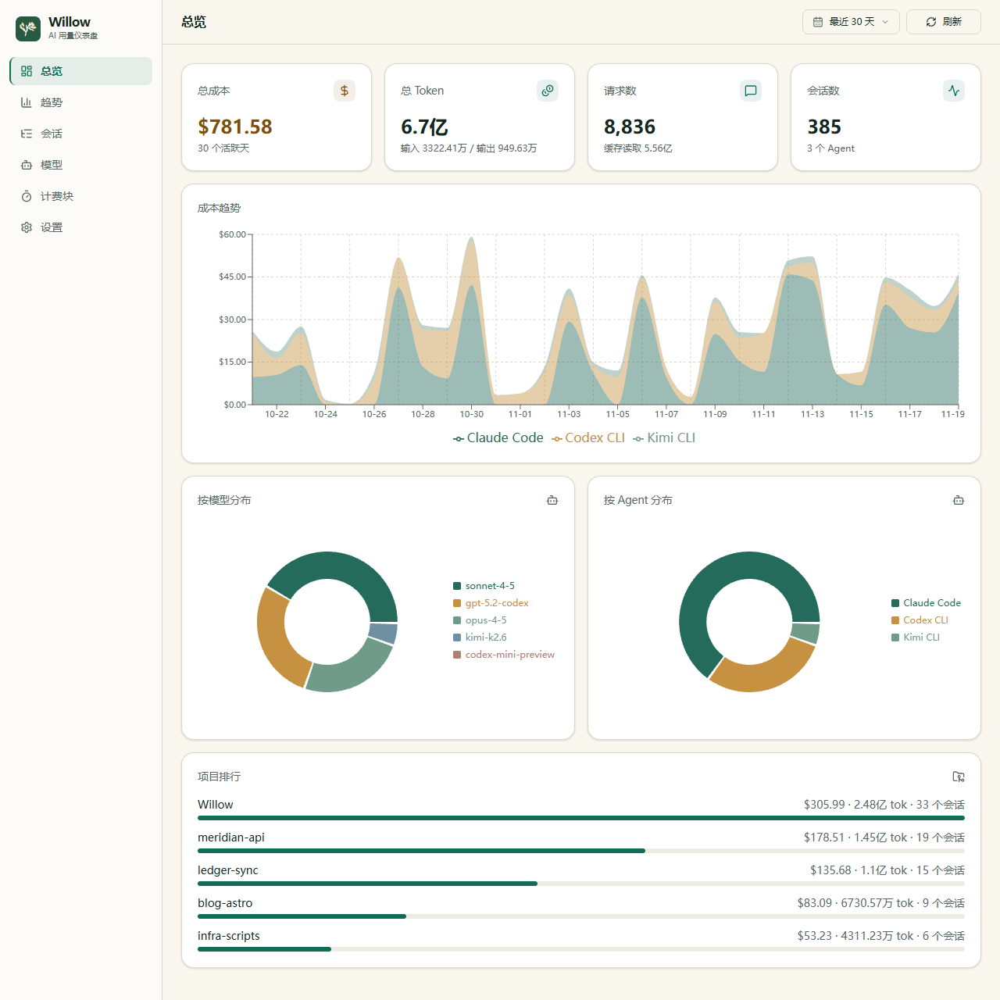

<div align="center">


# Willow · 柳

**开源的 Windows Token 统计工具，帮你看清 AI 编程用量。**

Willow 从本机日志读取 OpenAI Codex CLI、Claude Code、Kimi CLI 等工具的会话记录，汇总 Token 消耗并估算费用。Windows 有安装包，macOS 可从源码构建。

[](LICENSE)


[English](README.md) · **简体中文**

[下载 Windows x64 安装包](https://github.com/hey-pu/Willow/releases/latest) · [在 macOS 上从源码构建](#安装与构建)

</div>

## Willow 是什么？

Willow 把多个 AI 编程工具的本地用量汇总到一个桌面应用里。你可以比较输入、输出和缓存 Token，按天或按模型查看费用估算，也可以查到单个会话。从 Windows 系统托盘或 macOS 菜单栏可以打开快速面板。

统计范围以本机日志为准，费用按模型价格估算。实际账单和订阅额度请在服务商后台查看。Willow 将用量数据存储在本机 SQLite 数据库中，价格表可联网更新。

**Token 用量可以直接看「万／亿」。** 同样是 150,000,000 Token，中文单位显示 **1.5 亿**，国际单位显示 **150M**。在 **设置 → 外观 → Token 数量单位** 中切换。



## 功能特性

- **多 Agent 支持**：Claude Code、Codex CLI、Kimi CLI 开箱即用，适配器架构可继续扩展
- **费用估算**：支持长上下文计价、5 分钟/1 小时缓存写入价格、缓存读取折扣、fast/priority 档价格、按日期生效的调价和 DeepSeek 错峰价。价格变化后会重新计算已存储的估算费用
- **菜单栏实时显示**：今日成本或 Token 数直接显示在时钟旁边
- **5 小时计费块**：按 Agent 分别把用量分组到整点对齐的 5 小时窗口（对应 Claude、Codex 各自的用量窗口），附实时燃烧率
- **趋势与分布**：按日/周/月、按 Agent、按模型、按 Token 类型的图表
- **本地与隐私**：用量日志在本地解析并存储在 SQLite，价格表会定期联网刷新
- **深色/浅色主题**、多种主题色、中英文界面

## 支持的数据源

支持以下 AI Coding Agent，部分适配器逻辑移植自 ccusage。另有 Qoder IDE、Qoder CN 与 WorkBuddy 的 Windows 数据源支持：

| Agent | 数据位置 | 格式 |
|---|---|---|
| Claude Code | `$CLAUDE_CONFIG_DIR` / `~/.config/claude/projects` / `~/.claude/projects` | JSONL |
| Codex CLI (OpenAI) | `$CODEX_HOME` 下 `sessions/` 与 `archived_sessions/` | JSONL |
| Gemini CLI | `$GEMINI_DATA_DIR` 或 `~/.gemini/tmp` | JSON / JSONL |
| OpenCode | `$OPENCODE_DATA_DIR` 或 `~/.local/share/opencode` | SQLite + JSON |
| OpenClaw | `$OPENCLAW_DIR` 或 `~/.openclaw` | JSONL |
| GitHub Copilot CLI | `~/.copilot/otel/*.jsonl` | OTEL JSONL |
| Qwen Code | `$QWEN_DATA_DIR` 或 `~/.qwen` 下 `projects/*/chats/` | JSONL |
| Kimi CLI | `$KIMI_DATA_DIR` 或 `~/.kimi` 下 `sessions/**/wire.jsonl` | JSONL |
| Amp | `$AMP_DATA_DIR` 或 `~/.local/share/amp` 下 `threads/` | JSON |
| Droid (Factory) | `$DROID_SESSIONS_DIR` 或 `~/.factory/sessions` | JSON |
| Goose | Goose 数据目录或 `$GOOSE_PATH_ROOT` 下的 `sessions.db` | SQLite |
| Kilo | `$KILO_DATA_DIR` 或 `~/.local/share/kilo` 下的 `kilo.db` | SQLite |
| Codebuff | `~/.config/manicode*/projects` 或 `$CODEBUFF_DATA_DIR` | JSON |
| Hermes Agent | `$HERMES_HOME` 或 `~/.hermes` 下的 `state.db` | SQLite |
| pi-agent | `$PI_AGENT_DIR` 或 `~/.pi/agent/sessions` | JSONL |

本机没有数据的来源会自动检测并保持为空，不影响使用。新增一个 Agent 只需在 `src-tauri/src/adapters/` 加一个文件。

## 安装与构建

### Windows · 下载安装

从 [GitHub Releases](https://github.com/hey-pu/Willow/releases/latest) 下载 `Willow_0.4.0_x64-setup.exe`。这是未签名的 Windows x64 安装包。也可以在 Windows 上依次执行 `pnpm install --frozen-lockfile` 和 `pnpm tauri build --bundles nsis` 自行打包。

### macOS · 从源码构建

Willow 可以在 Apple Silicon 和 Intel Mac 上构建。GitHub Releases 暂未提供 macOS 安装包。在 Mac 上安装 Node.js、pnpm、Rust 和 [Tauri 所需依赖](https://v2.tauri.app/start/prerequisites/#macos)后，在项目目录运行：

```bash
pnpm install --frozen-lockfile
pnpm tauri build --bundles dmg
```

两种架构的磁盘映像都已通过 GitHub Actions 打包验证。Mac 上的安装、菜单栏和数据迁移仍待实测，公开安装包将在实测、Apple 签名和公证完成后再提供。

如果本机有兼容的旧版应用数据，请在首次启动 Willow 前完全退出旧应用。Willow 会在数据目录为空时导入旧版用量历史、设置与支持的偏好，包括订阅。

## 准确性

核心解析与计费逻辑移植自 [ccusage](https://github.com/ryoppippi/ccusage)（经过大量真实数据验证的实现）：

- 完整的 `message.usage` Token schema，含 `cache_creation` 的 `ephemeral_5m/1h` 细分
- 按 `messageId + requestId` 去重，冲突时保留 Token 更多的记录；Codex 重复上报（累计值不变）的事件只计一次
- LiteLLM 定价库（内嵌离线快照 + 每日在线刷新，GitHub 不可达时自动走 jsDelivr 镜像），模型名匹配优先采用厂商自己的价格而不是转售商；最新模型由内置官方价兜底
- 价格按每次请求的日期生效（例如 GPT-5.6 在 7、8 月的降价），fast/priority 档使用厂商公布的价格，超长 prompt 整次请求按长上下文价计费
- Cost Mode：`auto`（优先日志中的 costUSD）/ `calculate`（始终重算）/ `display`（只看 costUSD）
- 设置 → 定价 显示价格来源，并列出没有已知价格（按 $0 计）的模型
- Agent 清理旧日志后历史仍保留（Claude Code 默认删除 30 天前的会话记录）
- 与 ccusage 的有意差异：长上下文按整次请求计价、Codex 重复事件去重、较新模型的 fast 档价格

## 开发

```bash
pnpm install
pnpm tauri dev      # 开发模式
pnpm tauri build    # 打包（macOS .app/.dmg，Windows .msi/.exe）
```

后端端到端测试（扫描本机真实数据）：

```bash
cd src-tauri && cargo test --test pipeline -- --nocapture
```

### 架构

```
src-tauri/src/
├── adapters/        # 各 agent 数据源适配器
│   ├── claude.rs    # Claude Code JSONL 解析
│   ├── codex.rs     # Codex CLI 解析
│   ├── jsonl.rs     # 流式、可断点续读的 JSONL 读取
│   └── kimi.rs      # Kimi CLI 解析
├── pricing.rs       # LiteLLM 定价、内置/按日期生效的价格、模型匹配
├── cost.rs          # 支持长上下文的成本计算
├── db.rs            # SQLite 缓存：跳过未变化文件、只读追加部分、价格变化后重算
├── aggregate.rs     # daily/sessions/models/projects/blocks 聚合
├── types.rs         # 归一化 UsageRecord
└── lib.rs           # Tauri commands

src/
├── pages/           # 总览 / 趋势 / 会话 / 模型 / 计费块 / 设置
├── components/      # shadcn 风格 UI + Recharts 图表
└── lib/             # api.ts (typed invoke) / format.ts / i18n.tsx
```

数据流：启动时（及每 60s）增量扫描日志目录 → 解析归一化 → SQLite 去重落库（插入时按 LiteLLM 计价）→ 前端按时间范围/Cost Mode 查询聚合结果。

## 致谢

- [ccusage](https://github.com/ryoppippi/ccusage)：Willow 的解析与计费逻辑移植自该项目
- [Tauri](https://tauri.app) · [LiteLLM](https://github.com/BerriAI/litellm)（定价数据）· [Recharts](https://recharts.org)
- 特别感谢 [LinuxDO](https://linux.do/) 社区的认可与支持。

## 许可证

[MIT](LICENSE)。移植代码的许可见 [第三方许可声明](THIRD_PARTY_NOTICES.md)。
